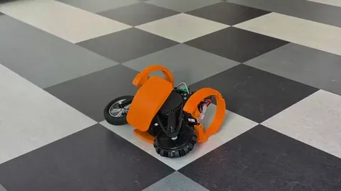
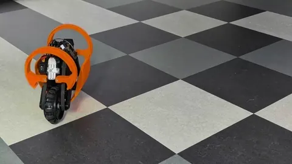
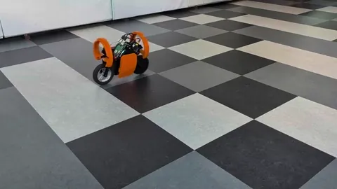
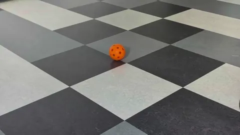
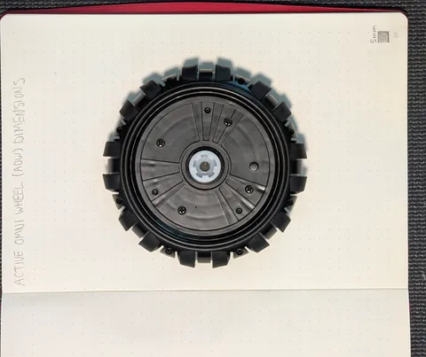
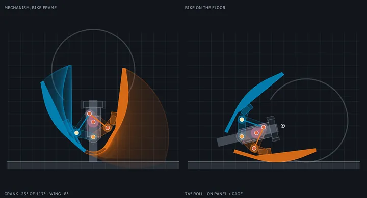
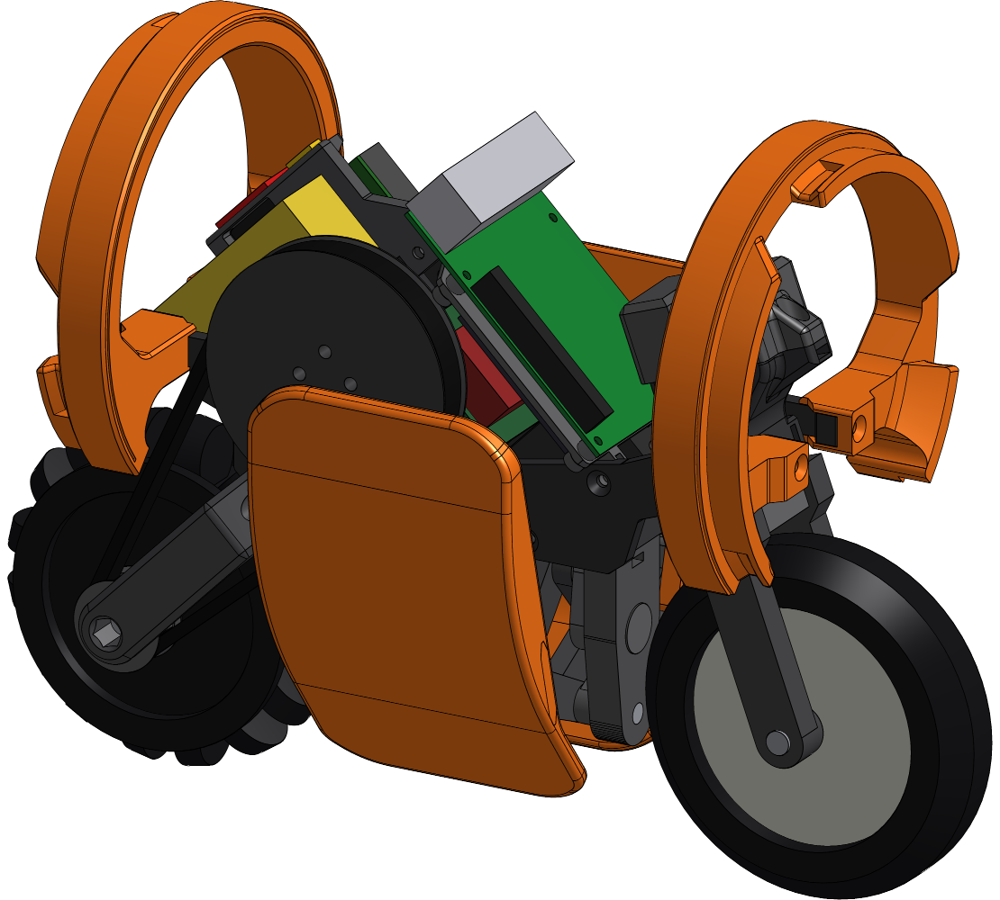

<h1 align="center">aow-bike-sim</h1>

  <em>A self-balancing and self-righting robot bike</em>

<!--
  Committed animated WebPs, so they loop on their own and render in a clone.
  docs/guide/media.md has the command behind each one and the GitHub-attachment
  route for anything too long to commit.
-->

<table>
<tr>
<td width="50%"></td>
<td width="50%"></td>
</tr>
<tr>
<td width="50%"></td>
<td width="50%"></td>
</tr>
</table>

  <em><a href="https://spiritlake.xyz/aow/#drive">Click here to take a test drive (browser demo)</a></em>

---

## How it learns to balance and drive

**One neural-network control policy handles both balance and ground movement.** It reads the bike's own sensors and a command — a velocity vector and a heading — and outputs the steering and drive servo targets, 50 times a second. There are no separate balance, drive and turn modes. Lying down and getting up are a scripted sequence on the righting servo, which hands over to the policy once the bike gets up.

  

**It learns in stages.** Training starts with the bike asked only to hold still or drive straight, slowly. After it learns to track easier commands, the difficulty increases: faster speeds, then turns in place, then turns on the move, until any heading change (up to a full 180°) can come at any speed.

  

**It learns entirely in simulation.** The sim is a MuJoCo model built from a single parameter file (`config/bike_params.yaml`), where each number is tagged with its source — measured, counted off gear teeth, read from a datasheet, or still a guess. The policy trains against a detailed simulation of the bike's sensors: a model of the AHRS's filtering and lag (measured on a fixture) and a velocity estimate (odometry) from the bike's simulated wheel and steering encoders.

**Training is performed on a GPU.** With the physics on the GPU (MuJoCo Warp) and thousands of bikes in parallel (PufferLib 5.0), a control policy is trained in ~80 million simulation steps. Training takes about 30 minutes on an RTX 5090, mostly pinning the GPU (VRAM < 4GB). Policies can also be trained on CPU, but 80M steps on a Mac M4 takes ~9 hours and is less parallelizable (~32 bikes in parallel instead of thousands).

## Active omni-wheel modelling

The rear wheel is an **active omni-wheel** from a toy bike, with two motors driving it as a differential. Turned together, they roll the wheel normally; turned against each other, they spin the rollers, and the wheel drives *sideways* under the bike.

  

The wheel is modelled in MuJoCo: 8 cone roller pairs driven through a bevel differential. Detailed wheel parameters were measured and incorporated into the GPU training, including periodic friction in the omni-wheel's geartrain ("roller detent") and play at the roller output ("roller slop").

## Self-righting linkage modelling

One servo is responsible for getting the bike back up when it falls, and swinging a side panel down like a kickstand to rest upright. A mirrored linkage operates asymmetrically to deploy panels on either side:

   
  <em>The linkage through its stroke in the bike's frame (left) and on the floor (right).</em> 
  <em><a href="https://spiritlake.xyz/aow/linkage">Click here to see the detailed mechanism analysis (browser demo)</a></em>

The mechanism is optimized (`scipy differential_evolution`) to minimize the peak servo torque through its stroke (quasi-static), while maintaining the required geometry; candidate mechanisms are then validated in the dynamic MuJoCo physics simulation.

## Hardware

For development, I used 12V Dynamixel servos (XC430-W150 for the drives, XC330-T181 for steering and righting), with a Linux SBC (Raspberry Pi) as the controller and a SYD Dynamics TM151 AHRS for orientation sensing.

The servo control loop runs at 100Hz, with the control policy updating every second step (50Hz). The control policy is tiny, with ~200KB of fp32 weights and about 0.1 MFLOP per step (~5 MFLOP/s), so a much smaller onboard computer can be used. A 9-axis AHRS (with a magnetometer) gives the control policy an absolute heading to hold; a 6-axis IMU's yaw would drift, so heading would have to come from elsewhere, such as steering and odometry.

   

The CAD is generated from the same parameter file as the simulator (`config/bike_params.yaml`): Python emits Onshape FeatureScript for each module (drivetrain, steering, righting linkage, chassis), so a dimension that changes in the sim moves the CAD. Fit details and smoothing were finished by hand in Onshape on top of the rough layout and subassemblies. All parts were 3D printed from ASA filament and assembled with countersunk machine screws and embedded nuts.

## Docs

If you're interested in running the code, you can try **[Getting started](docs/guide/getting-started.md)** to install the base Python code, drive the bike in the sim, and see a map of the repo.

## Credits

Built on [MuJoCo](https://mujoco.org),
[MuJoCo Warp](https://github.com/google-deepmind/mujoco_warp),
[PufferLib](https://github.com/PufferAI/PufferLib) and
[Stable-Baselines3](https://stable-baselines3.readthedocs.io).
